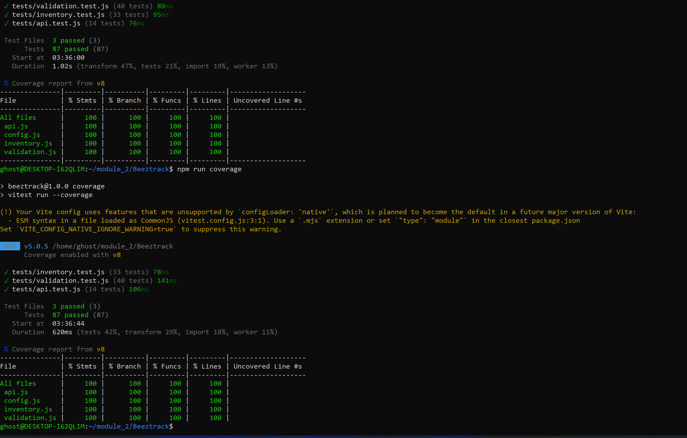

# Beeztrack

A simple inventory management system for small business owners. Add products,
track stock levels, get low-stock warnings, search and filter your inventory,
and see the total value of your stock at a glance.

**Live app:** <https://whitestrick.github.io/Beeztrack/>
**Live API:** <https://beeztrack-api.onrender.com/products>
**Figma wireframe:** <FIGMA LINK, added in the Figma issue>

> **Heads up:** the API runs on a free hosting tier that sleeps after 15
> minutes of inactivity. The first load can take up to a minute while the
> server wakes up. See [Known limitations](#known-limitations).

## Table of contents

1. [Project overview](#project-overview)
2. [Objectives](#objectives)
3. [MVP features](#mvp-features)
4. [User stories](#user-stories)
5. [Technologies used](#technologies-used)
6. [Project structure](#project-structure)
7. [Setup instructions](#setup-instructions)
8. [API endpoints](#api-endpoints)
9. [How the code is organised](#how-the-code-is-organised)
10. [Testing](#testing)
11. [Accessibility](#accessibility)
12. [Responsive design](#responsive-design)
13. [Design decisions](#design-decisions)
14. [Deployment](#deployment)
15. [Known limitations](#known-limitations)
16. [Future improvements](#future-improvements)
17. [License](#license)

## Project overview

Beeztrack is a single-page application (SPA) built with HTML, CSS and vanilla
JavaScript (ES modules). It talks to a JSON Server REST API for all its data,
so changes survive a page refresh. A public API (DummyJSON) provides sample
products so a new user can fill the inventory with one click.

## Objectives

- Integrate an API with request and response handling, loading states and
  error handling.
- Demonstrate RESTful CRUD using all five HTTP methods: GET, POST, PUT,
  PATCH and DELETE.
- Write modular, maintainable JavaScript with HTML, CSS and JS kept separate.
- Validate user input and give clear feedback.
- Reach at least 50% automated test coverage.
- Build an accessible, responsive interface with a limited colour palette.
- Use feature branches, pull requests and a project board.
- Deploy both the frontend and the backend.

## MVP features

1. **Product management (CRUD):** add, view, edit and delete products.
2. **Stock level monitoring:** each product has a minimum stock level. Rows
   show a coloured stripe and a text badge (OK, Low or Out).
3. **Search and filter:** search by name and filter by category and stock
   status. The filters work together.
4. **API data persistence:** products are loaded from and saved to a JSON
   Server backend.
5. **Inventory summary:** total products, total inventory value
   (price x quantity), low-stock count and out-of-stock count.

Extra: quick **+ / -** quantity buttons, and **import sample products** from
the DummyJSON public API.

## User stories

- As a shop owner, I want to add a product with a name, quantity and price so
  that I can track what I have.
- As a user, I want to quickly increase or decrease a product's quantity so
  that I can update stock after a sale or delivery.
- As a user, I want to be warned when an item is running low so that I can
  restock in time.
- As a user, I want to search and filter products so that I can find items
  fast.
- As a user, I want to see the total number of products and the total value of
  my inventory so that I understand my stock at a glance.
- As a new user, I want to import sample products so that I can try the app
  without typing data.

## Technologies used

| Area | Technology |
|---|---|
| Structure | Semantic HTML5 |
| Styling | CSS3 (variables, flexbox, grid, media queries) |
| Logic | JavaScript (ES modules, async/await, fetch) |
| Backend | JSON Server 0.17.4 (mock REST API) |
| Public API | [DummyJSON Products](https://dummyjson.com/products) |
| Testing | Vitest <ADD jsdom or coverage provider if used (check)> |
| Hosting | GitHub Pages (frontend), Render (API) |
| Design | Figma, Google Fonts (Bricolage Grotesque, DM Sans) |
| Workflow | Git, GitHub Issues, GitHub Projects board, pull requests |

## Project structure

```
Beeztrack/
├── index.html          # the single page (semantic HTML, no inline JS)
├── css/
│   └── style.css       # design tokens, layout, components, responsive rules
├── js/
│   ├── config.js       # API base URL and public API URL (single place)
│   ├── api.js          # all server communication (fetch wrapper + CRUD)
│   ├── inventory.js    # pure logic: stock status, summary, filters
│   ├── validation.js   # form validation (returns messages, no DOM)
│   ├── ui.js           # everything that touches the page
│   └── app.js          # entry point: state, event listeners
├── tests/              # unit tests
├── docs/               # design reference and coverage screenshot
├── db.json             # seed data for JSON Server
└── package.json
```

## Setup instructions

**Requirements:** Node.js (LTS) and a way to serve static files, such as the
VS Code *Live Server* extension. Opening `index.html` directly will not work,
because ES modules need a server.

```bash
# 1. Clone and install
git clone https://github.com/whitestrick/Beeztrack.git
cd Beeztrack
npm install

# 2. Start the local API (http://localhost:3000)
npm start

# 3. Serve the page, for example with Live Server
#    (right-click index.html > Open with Live Server)
```

To use the local API instead of the live one, set `API_BASE_URL` in
`js/config.js` to `http://localhost:3000` (no trailing slash).

```bash
# Run the tests
npm test

# Run the tests with a coverage report
npm run coverage
```

## API endpoints

Base URL: `https://beeztrack-api.onrender.com`

| Method | Endpoint | Used for | Body |
|---|---|---|---|
| GET | `/products` | Load all products | none |
| POST | `/products` | Add a product, and import samples | full product (no id) |
| PUT | `/products/:id` | Save the edit form (replaces the whole record) | full product |
| PATCH | `/products/:id` | The + / - quantity buttons | `{ "quantity": 5 }` |
| DELETE | `/products/:id` | Delete a product | none |

**Product shape**

```json
{
  "id": 1,
  "name": "Bluetooth Speaker",
  "category": "Electronics",
  "price": 45,
  "quantity": 40,
  "minStock": 5,
  "image": ""
}
```

**Public API:** `GET https://dummyjson.com/products?limit=20`. Each product is
mapped (`title` to `name`, `stock` to `quantity`, `thumbnail` to `image`),
given a default minimum stock, and POSTed to the Beeztrack API.

**Stock rule:** `out` when quantity is 0, `low` when quantity is at or below
the minimum stock, otherwise `ok`.

## How the code is organised

| Module | Responsibility |
|---|---|
| `config.js` | The only place that knows the API addresses |
| `api.js` | Sends requests, parses JSON, turns failures into clear errors |
| `inventory.js` | Pure functions: stock status, summary, filtering, categories |
| `validation.js` | Checks form values and returns messages per field |
| `ui.js` | Draws the table, cards, dialogs and messages (uses `textContent`, never `innerHTML`) |
| `app.js` | Keeps the state, listens for events, connects the other modules |

Key ideas: the `products` array is the single source of truth, and one
`refreshView()` function redraws the table and the cards from it. One click
listener on the table handles edit, quantity and delete buttons (event
delegation).

## Testing

Tests run with Vitest. <N> tests pass.



**Coverage:** <STATEMENTS>% statements, <BRANCHES>% branches,
<FUNCTIONS>% functions, <LINES>% lines.

**Scope:** <EXPLAIN HONESTLY WHAT IS MEASURED. For example: "Coverage is
measured on the logic modules (`validation.js`, `inventory.js`, `api.js`),
which hold the application rules and can be tested without a browser. `ui.js`
and `app.js` manipulate the DOM and are verified manually."> (check against
your real coverage configuration)

## Accessibility

- Semantic landmarks, a skip link, labelled form fields and `aria-required`
- Error messages linked to fields with `aria-describedby`
- A live region announces search results and quantity changes to screen readers
- Stock status uses a stripe, a tint **and** a text badge, never colour alone
- Visible keyboard focus and keyboard-operable dialogs
- Respects `prefers-reduced-motion`

**Lighthouse accessibility score:** 

## Responsive design

Desktop shows a table. On tablet the toolbar wraps, and on mobile each product
becomes a stacked card. The layout uses `rem`, `fr`, flexbox, grid and media
queries.

## Design decisions

- **Three colours plus neutrals.** Honey Amber (actions), Ink (structure and
  text) and Signal Red (problems only: out of stock, delete, errors).
  Neutrals: paper, white, a line colour and a grey text colour.
- **Amber is never used as text on white**, because the contrast is too low.
  It appears only as a background, with dark text on it.
- **No green.** Success messages use an amber stripe and a check mark, to keep
  to three colours.
- **Fonts:** Bricolage Grotesque for headings and DM Sans for body text.
- **Categories are free text** with suggestions, so any kind of business can
  use its own categories.
- **Figma wireframe:** <FIGMA LINK>

## Deployment

| Part | Host | URL |
|---|---|---|
| Frontend | GitHub Pages (from `main`) | <https://whitestrick.github.io/Beeztrack/> |
| API | Render, free web service | <https://beeztrack-api.onrender.com> |

The frontend finds the API through one constant in `js/config.js`.

**Persistence test (<DATE>):** <WHAT YOU OBSERVED. For example: "I added a
product on the live API, restarted the service from the Render dashboard, and
the product was gone. The API returned to the seed data in `db.json`.">

## Known limitations

- **Free-tier data does not last.** Render's free web services have an
  ephemeral filesystem and sleep after 15 minutes without traffic. Data saved
  to `db.json` is lost on a restart, redeploy or spin-down, and the API returns
  to its seed data. Data does persist across page reloads while the server is
  awake.
- **Slow first load.** After sleeping, the first request can take up to a
  minute. The loading message explains this.
- **Validation is for usability, not security.** The checks run in the
  browser. A production backend would validate again, because anyone can send
  requests without the form.
- **No authentication.** JSON Server has no real login system. Anyone with the
  API address can read and change the data.
- **Categories match exactly.** "Office" and "office" count as different
  categories.

## Future improvements

- Replace JSON Server with a real backend and a database such as PostgreSQL,
  which fixes data loss and adds real validation.
- User accounts so each business owner has a separate inventory (login,
  per-user products, hashed passwords and tokens).
- Normalise category names and add sorting.
- Export inventory to CSV.

## License

Released under the [MIT License](LICENSE).